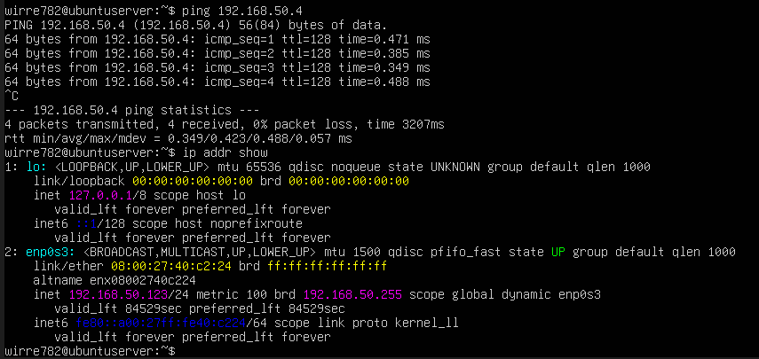

# Labbmiljö, Git, CLI och AI
**Namn:** Victor Huss

**Kurs:** Introduktion till yrkesrollen och grunderna i IT-infrastruktur

**Labbdatum:** 2026-09-17

**Inlämningsdatum:** 2026-10-02

---

### Genomförande

1. En Ubuntu Server sattes upp i VirtualBox
1. De virituella nätverkskorten ändrades till bridged så de två virituella maskinerna är på samma närverk.
1. Genomförde Linux delen av del 3, behövde tillåta ping i Windows Firewall

---

Tabell
| hostname | Operativsystem | IP-adress | Subnät | Standard Gateway|
| -------- | --------------- | --------- | ------ | ---------------|
| VirtualBx | Windows 11 Professional | 192.168.50.4| 255.255.255.0| 192.168.50.1|
| ubuntuserver | Ubuntu Server 26.04.1 LTS | 192.168.50.123 | 255.255.255.0 | 192.168.50.1

<!-- 1. Titel & Introduktion: Namn, datum, kurs och kort beskrivning av labbmiljön.
2. Labbmiljö & Nätverk (Kursmål 8): Nätverkstabell och beskrivning av uppsättningen.
3. Kommandoradsgenomförande (Kursmål 9): Steg-för-steg-dokumentation (med
CLI-kommandon och skärmdumpar/kodblock) för både Linux och Windows.
4. Git & Versionshantering (Kursmål 10): Länk till ditt Git-repository samt
utskrift/skärmdump på din git log --oneline som visar din ändringshistorik.
5. AI-logg & Reflektion (Kursmål 11): Prompt, AI-utdata och din kritiska granskning. -->