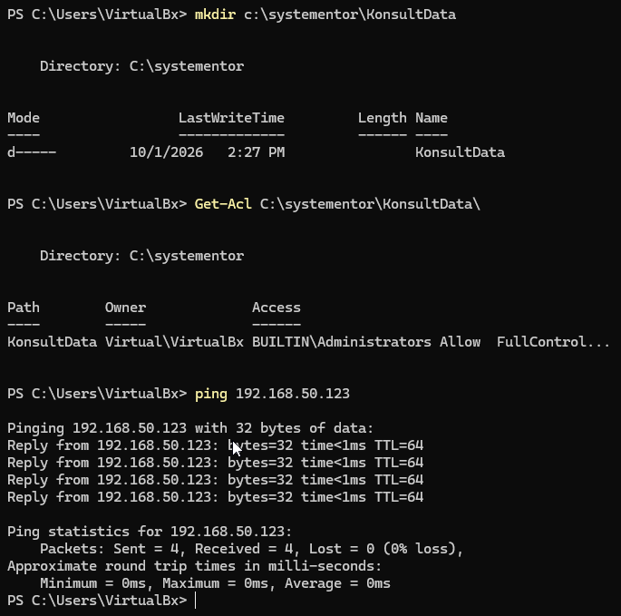

# Labbmiljö, Git, CLI och AI
**Namn:** Victor Huss

**Kurs:** Introduktion till yrkesrollen och grunderna i IT-infrastruktur

**Labbdatum:** 2026-09-17

**Inlämningsdatum:** 2026-10-02

---

### Genomförande

1. En Ubuntu Server sattes upp i VirtualBox
1. De virituella nätverkskorten ändrades till bridged så de två virituella maskinerna är på samma närverk.
1. Genomförde Linux delen av del 3, behövde tillåta ping i Windows Firewall


1. Genomförde Windows delen


---

Tabell
| hostname | Operativsystem | IP-adress | Subnät | Standard Gateway|
| -------- | --------------- | --------- | ------ | ---------------|
| VirtualBox | Windows 11 Professional | 192.168.50.4| 255.255.255.0| 192.168.50.1|
| ubuntuserver | Ubuntu Server 26.04.1 LTS | 192.168.50.123 | 255.255.255.0 | 192.168.50.1

---

## AI-logg & Reflektion
Jag valde [Claud.ai](https://claude.ai) som mitt AI-verktyg.

Jag använde prompten: 
 *Du är en lärare inom linux system, förklara hur chmod kommandot fungerar i linux, bryt ner den steg för steg hur den fungerar och ge exempel hur man använder det i praktiken.* Och fick svaret, [så här såg det ut](Resultat.md).

Från min granskning var allt AI-n sa korrekt, det är antagligen på grund av att jag valde ett ganska grundläggande kommando som är väldokumenterat, om jag hade tagit ett lite mer oanvänt kommando så behöver jag vara mer varsam och dubbelkolla med andra källor, även flera som inte är AI. Chmod är också ett kommando som inte ändras och även om det finns andra kommandon för att ändra rättigheter i Linux så är ingen av dem objektivt bättre och på så sätt inte tagit över som standard kommandot gällande filrättigheter som har hänt vissa andra kommandon i linux, exempel ifconfig där man bör använda ip kommandot med rätt flaggor.


Kommandot git log --oneline:
```powershell
PS D:\gitTest\Labb-git-cli-ai> git log --oneline
f7ae97e (HEAD -> main, origin/main) Added README as a link file, hopefully this will work.
dc983da Added Ai reflection and its promt as seperate .md file
646e141 Added image for Windows part
e473aa1 Added images for linux part
a9944cb Added table of system info
3446092 added pdf
e43d52d first init
```


<!-- 1. Titel & Introduktion: Namn, datum, kurs och kort beskrivning av labbmiljön.
2. Labbmiljö & Nätverk (Kursmål 8): Nätverkstabell och beskrivning av uppsättningen.
3. Kommandoradsgenomförande (Kursmål 9): Steg-för-steg-dokumentation (med
CLI-kommandon och skärmdumpar/kodblock) för både Linux och Windows.
4. Git & Versionshantering (Kursmål 10): Länk till ditt Git-repository samt
utskrift/skärmdump på din git log --oneline som visar din ändringshistorik.
5. AI-logg & Reflektion (Kursmål 11): Prompt, AI-utdata och din kritiska granskning. -->